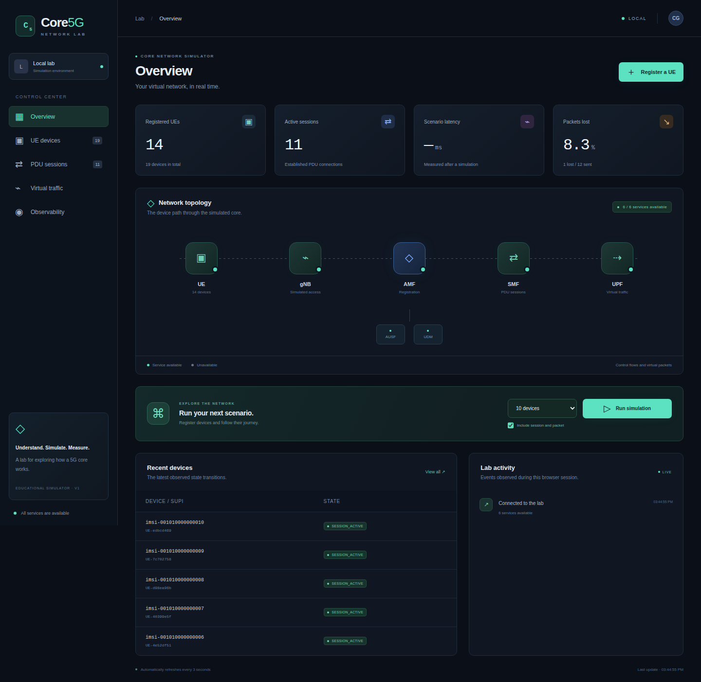
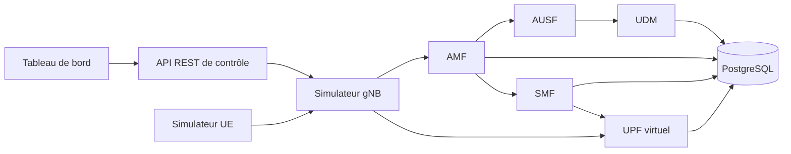

# Core5G

**Simulateur pédagogique de cœur de réseau 5G, développé en Go avec des services gRPC, PostgreSQL et une interface de pilotage.**

Core5G permet de suivre un terminal depuis son enregistrement jusqu'à la création d'une session PDU et l'envoi de paquets virtuels. Le projet met en pratique les systèmes distribués : contrats Protobuf, machines à états, idempotence, persistance, gestion des pannes et observabilité.

[Cahier des charges V2.0](docs/cahier-des-charges.pdf) · [Architecture](docs/architecture.md) · [API](docs/api.md) · [Validation](docs/validation.md) · [Pull requests](https://github.com/ABDOUUisHERE/core5g/pulls)



## Essayer le projet

Prérequis : Git, Docker avec Compose, Python 3 et plusieurs Go d'espace disque libre. Docker Desktop doit être démarré sous Windows. Le tableau de bord est embarqué dans le binaire Go ; Node.js sert uniquement aux tests navigateur.

La version complète est disponible sur la branche `main` :

```sh
git clone https://github.com/ABDOUUisHERE/core5g.git
cd core5g
docker compose up --build -d --wait
python scripts/demo.py
```

La démonstration enregistre un terminal, ouvre une session et envoie un paquet virtuel. Ouvrir ensuite **http://127.0.0.1:8085** pour piloter le laboratoire.

| Interface | Adresse locale | Usage |
| --- | --- | --- |
| Network Lab | http://127.0.0.1:8085 | Terminaux, abonnés, sessions, trafic et scénarios |
| Grafana | http://127.0.0.1:3005 | Tableau de bord provisionné, huit panneaux |
| Prometheus | http://127.0.0.1:9095 | Métriques des services |
| Jaeger | http://127.0.0.1:16686 | Traces des appels entre services |

Le laboratoire initialise 1 000 profils synthétiques, de `imsi-001010000000001` à `imsi-001010000001000`, avec l'identifiant d'authentification fictif `demo-key`. Les profils inconnus ou désactivés sont refusés.

```sh
# Vérifier les parcours et les cas d'échec
python tests/e2e/acceptance.py

# Exécuter le simulateur de terminal
docker compose run --rm ue-simulator

# Mesurer 1 000 enregistrements avec 50 workers
python tests/performance/load.py --count 1000 --concurrency 50

# Arrêter le laboratoire en conservant ses données
docker compose down
```

PostgreSQL conserve les données dans un volume nommé. `docker compose down -v` efface volontairement les données du laboratoire. Les migrations d'initialisation s'exécutent sur un volume neuf.

## Fonctionnalités

- **Enregistrement des UE** : validation des identités, authentification synthétique et transitions d'état contrôlées.
- **Sessions PDU** : allocation d'IP uniques, création et libération idempotentes, compensation des échecs.
- **Trafic virtuel** : compteurs de paquets et d'octets, latence, gigue et pertes reproductibles.
- **Pilotage** : API REST, tableau de bord responsive, scénarios en arrière-plan et injection de pannes.
- **Observabilité** : métriques Prometheus, tableaux Grafana, logs JSON corrélés et traces OpenTelemetry/Jaeger.
- **Persistance** : schémas et comptes PostgreSQL propres à chaque service, contraintes d'unicité et contrôle des accès.
- **Déploiement** : Docker Compose et cluster Kubernetes local avec Kind, sondes de santé et conteneurs Go sans privilèges root.

## Architecture



Les services communiquent par gRPC à travers des contrats Protobuf. Chacun possède son schéma de données ; l'API de contrôle agrège les résultats. Les métriques et les traces permettent d'observer le parcours complet d'une requête.

| Composant | Responsabilité simulée |
| --- | --- |
| UE / gNB | Terminal et point d'entrée dans le réseau |
| AMF | Enregistrement et cycle de vie des terminaux |
| AUSF / UDM | Authentification fictive et profils des abonnés |
| SMF | Cycle de vie des sessions et allocation d'IP |
| UPF | Acheminement virtuel et compteurs de trafic |
| Control API | Interface REST et tableau de bord embarqué |

## Qualité et résultats mesurés

La [CI GitHub Actions](https://github.com/ABDOUUisHERE/core5g/actions/workflows/ci.yml) vérifie le formatage, `go vet`, les tests avec détection des accès concurrents, les contraintes PostgreSQL, les parcours E2E, le navigateur et les déploiements Compose/Kind. Les artefacts conservent les rapports et les captures. Le détail des vérifications est disponible dans la [documentation de validation](docs/validation.md).

| Vérification | Résultat retenu |
| --- | --- |
| Couverture des cinq packages métier critiques | De 83,5 % à 100 % ; seuil CI de 80 % par package |
| Acceptation Compose et Kind | Six groupes de tests couvrant T01–T09 réussis |
| Interface navigateur | Cinq vues vérifiées à 1 440, 768, 390 et 320 px |
| Observabilité | Sept cibles Prometheus, huit panneaux Grafana et traces entre plusieurs services |
| Charge de référence : 1 000 requêtes, 50 workers | 1 000 succès, aucune erreur, p95 de 153,04 ms |
| Rafale synchronisée : 1 000 tentatives, pic observé de 998 requêtes en vol | 960 succès, 40 erreurs HTTP 504, p95 global de 2 095,667 ms |

La charge de référence a été mesurée sur un runner Ubuntu avec 4 CPU logiques et environ 16 Go de RAM, avec l'observabilité activée. Le [rapport brut](docs/evidence/performance-compose.json) décrit l'environnement. La rafale suivante est conservée dans les artefacts de [cette exécution CI](https://github.com/ABDOUUisHERE/core5g/actions/runs/39615400915).

Les objectifs de p95 inférieur à 100 ms et de 1 000 enregistrements simultanés réussis restent à atteindre. Les optimisations sont suivies dans [l'issue #19](https://github.com/ABDOUUisHERE/core5g/issues/19). Consulter la [méthodologie de mesure](docs/performance.md) avant d'interpréter ces résultats.

## Développement

Go 1.25 est requis pour travailler directement sur le code. Les bindings Protobuf générés sont inclus.

```sh
go test ./... -cover
go test -race ./...
go vet ./...

# Régénérer les contrats avec Docker et Make
make tools proto

# Tests navigateur : Node.js et Chromium requis, laboratoire démarré
npm ci
npx playwright install chromium
npm run test:browser
```

Sous Windows sans installation locale de Go, les commandes suivantes utilisent Docker :

```powershell
powershell -ExecutionPolicy Bypass -File scripts/go.ps1 -Task test
powershell -ExecutionPolicy Bypass -File scripts/go.ps1 -Task race
powershell -ExecutionPolicy Bypass -File scripts/go.ps1 -Task vet
```

Les tâches `build`, `tools` et `proto` sont aussi disponibles. Pour un aperçu Windows sans Docker, télécharger l'artefact CI `core5g-windows`, extraire le binaire dans `bin/core5g.exe`, puis exécuter :

```powershell
powershell -ExecutionPolicy Bypass -File scripts/local-lab.ps1 -Binary .\bin\core5g.exe
# Après la démonstration
powershell -ExecutionPolicy Bypass -File scripts/local-lab.ps1 -Stop
```

Cet aperçu utilise une mémoire volatile et ne démarre ni PostgreSQL ni les outils d'observabilité. Compose constitue le déploiement persistant de référence. Un [guide Kind/Kubernetes](docs/kubernetes.md) décrit le second mode de déploiement.

## Organisation du dépôt

```text
api/          Contrats Protobuf et bindings générés
cmd/          Points d'entrée des services et simulateurs
internal/     Logique métier, transports et persistance
migrations/   Schémas, comptes et contraintes PostgreSQL
deployments/  Docker, observabilité et Kubernetes
scripts/      Démonstration, outils et automatisation GitHub
tests/        Intégration, E2E, navigateur et charge
docs/         Architecture, ADR, exigences et preuves
```

Le travail suit des issues, des branches dédiées, des Conventional Commits et des PR avec validation. Les fonctionnalités livrées sont intégrées dans `main`. Le [guide de contribution](CONTRIBUTING.md) précise le fonctionnement des revues ; le [suivi GitHub](https://github.com/ABDOUUisHERE/core5g/pulls) fait foi pour l'état des fusions.

## Documentation et limites

- [Exigences et critères d'acceptation](docs/requirements.md)
- [Feuille de route](docs/ROADMAP.md)
- [Décisions d'architecture](docs/adr/)
- [Référence de l'API](docs/api.md)
- [Démonstration et scénarios d'échec](docs/demo.md)
- [Captures et preuves de validation](docs/evidence/)

Core5G est un laboratoire pédagogique. L'authentification est fictive et le trafic est virtuel ; NAS, NGAP, 5G-AKA et GTP-U ne sont pas implémentés. La topologie prend en charge une seule instance active par service avec état. L'API d'administration et les identifiants de démonstration sont destinés à un environnement local de confiance. La conformité 3GPP et la sécurité d'un cœur 5G de production sont hors périmètre.
