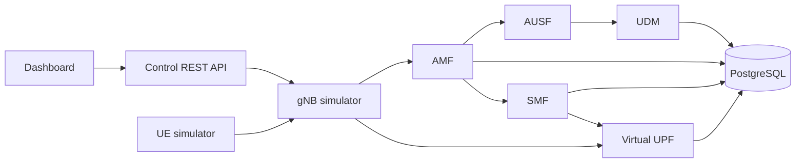

# Core5G

**An educational 5G core network simulator built with Go, gRPC, PostgreSQL and an interactive control dashboard.**

Follow a synthetic device from registration and fictional authentication to PDU session creation and virtual packet delivery. Core5G demonstrates service boundaries, state machines, idempotency, persistence, failure recovery and observability.

[First-run testing guide](docs/testing.md) · [Specification V2.0](docs/specification.md) · [Architecture](docs/architecture.md) · [API](docs/api.md) · [Validation](docs/validation.md)


## Quick start

Prerequisites: Git, Docker with Compose, Python 3 and several GB of free disk space. Start Docker Desktop on Windows. The dashboard is embedded in the Go binary; Node.js is only needed for optional browser tests.

```sh
git clone https://github.com/ABDOUUisHERE/5G-Core-Network-Simulator.git
cd 5G-Core-Network-Simulator
docker compose up --build -d --wait
python scripts/demo.py
```

If the repository is already open in your IDE, run the last two commands from its root. Open **http://127.0.0.1:8085**. The demo registers a device, creates a session and sends a virtual packet.

| Interface | Local URL | Purpose |
| --- | --- | --- |
| Network Lab | http://127.0.0.1:8085 | Devices, subscribers, sessions, traffic and scenarios |
| Grafana | http://127.0.0.1:3005 | Provisioned dashboard with eight panels |
| Prometheus | http://127.0.0.1:9095 | Service metrics and queries |
| Jaeger | http://127.0.0.1:16686 | Request traces across services |

The lab seeds 1,000 synthetic subscribers, from `imsi-001010000000001` to `imsi-001010000001000`, with the fictional credential `demo-key`. Unknown or disabled subscribers are rejected.

## Try your first scenario

1. Click **Register a UE** and keep the demonstration values.
2. In **UE devices**, find the registered device and click **Session**.
3. Open **PDU sessions** and confirm an `ACTIVE` session with a virtual IP.
4. Click **Packet**, or use **Virtual traffic** to send several packets.
5. Inspect the counters, then click **Release** to close the session.

For a repeatable automatic check:

```sh
python tests/e2e/acceptance.py
```

The expected outcome is six passing test groups and `OK`. See the [testing guide](docs/testing.md) for failure scenarios, Windows preview, troubleshooting and further checks.

## Features

- **UE registration:** synthetic identity validation, fictional authentication and controlled state transitions.
- **PDU sessions:** unique IP allocation, idempotent creation/release and durable compensation.
- **Virtual traffic:** packet/byte counters and reproducible latency, jitter and loss.
- **Control:** REST API, responsive dashboard, background scenarios and fault injection.
- **Observability:** Prometheus metrics, Grafana panels, correlated JSON logs and OpenTelemetry/Jaeger traces.
- **Persistence:** service-owned PostgreSQL schemas and logins, uniqueness constraints and access isolation.
- **Deployment:** Docker Compose and local Kubernetes/Kind, health probes and nonroot Go containers.

## Architecture



Services communicate through versioned Protobuf contracts over gRPC. Each owning service has its own database schema. The control API aggregates results, while metrics and traces expose the request path.

| Component | Simulated responsibility |
| --- | --- |
| UE / gNB | Device and network entry point |
| AMF | Device registration and lifecycle |
| AUSF / UDM | Fictional authentication and subscriber profiles |
| SMF | Session lifecycle and IP allocation |
| UPF | Virtual forwarding and traffic counters |
| Control API | REST endpoints and embedded dashboard |

## Quality and measured results

[GitHub Actions](https://github.com/ABDOUUisHERE/5G-Core-Network-Simulator/actions/workflows/ci.yml) checks formatting, `go vet`, race detection, PostgreSQL constraints, E2E scenarios, browser behavior, observability and Compose/Kind deployments. Reports and screenshots are retained as artifacts. See [validation status](docs/validation.md) for evidence and limitations.

| Check | Retained result |
| --- | --- |
| Five critical business packages | Coverage from 83.5% to 100%; CI floor of 80% per package |
| Compose and Kind acceptance | Six passing test groups covering T01-T09 |
| Browser interface | Five views checked at 1440, 768, 390 and 320 pixels |
| Observability | Seven scraped services, eight Grafana panels and multi-service traces |
| Baseline: 1,000 requests, 50 workers | 1,000 successes, no errors, p95 of 153.04 ms |
| Synchronized burst: 1,000 attempts, observed peak of 998 in flight | 960 successes, 40 HTTP 504 responses, all-request p95 of 2095.667 ms |

The baseline was measured on an Ubuntu runner with four logical CPUs and approximately 16 GB RAM, with observability enabled. The [raw report](docs/evidence/performance-compose.json) records the environment. The subsequent burst is retained in the artifacts of [this CI run](https://github.com/ABDOUUisHERE/5G-Core-Network-Simulator/actions/runs/39615400915).

The sub-100-ms p95 and 1,000 successful simultaneous registrations remain targets. Optimization work is tracked in [issue #19](https://github.com/ABDOUUisHERE/5G-Core-Network-Simulator/issues/19). Read the [measurement methodology](docs/performance.md) before interpreting the results.

## Development and tests

Go 1.25 is required for native development. Generated Protobuf bindings are committed.

```sh
go test ./... -cover
go test -race ./...
go vet ./...

# Regenerate Protobuf bindings with Docker and Make
make tools proto

# Browser tests: Node.js, Chromium and a running lab are required
npm ci
npx playwright install chromium
npm run test:browser
```

On Windows without Go, run these commands through Docker:

```powershell
powershell -ExecutionPolicy Bypass -File scripts/go.ps1 -Task test
powershell -ExecutionPolicy Bypass -File scripts/go.ps1 -Task race
powershell -ExecutionPolicy Bypass -File scripts/go.ps1 -Task vet
```

The helper also supports `build`, `tools` and `proto`. A Windows executable is available in the `core5g-windows` artifact of a successful CI run. For a preview without Docker, extract it to `bin/core5g.exe` and run:

```powershell
powershell -ExecutionPolicy Bypass -File scripts/local-lab.ps1 -Binary .\bin\core5g.exe
# Stop the preview after testing
powershell -ExecutionPolicy Bypass -File scripts/local-lab.ps1 -Stop
```

The preview uses volatile in-memory storage and does not start PostgreSQL or the observability tools. Compose is the reference persistent deployment. See the [Kind/Kubernetes guide](docs/kubernetes.md) for a local cluster deployment.

## Stop the lab

```sh
docker compose down
```

PostgreSQL data survives normal shutdown in a named volume. `docker compose down -v` deliberately deletes lab data. Initialization migrations run on a new volume, not on every restart.

## Repository layout and workflow

```text
api/          Protobuf contracts and generated bindings
cmd/          Service and simulator entry points
internal/     Business logic, transports and persistence
migrations/   PostgreSQL schemas, accounts and constraints
deployments/  Docker, observability and Kubernetes
scripts/      Demonstration, tooling and GitHub automation
tests/        Integration, E2E, browser and load tests
docs/         Specifications, architecture, ADRs and evidence
```

Development follows issues, dedicated branches, Conventional Commits and validated pull requests. Delivered features are integrated into `main`. The [contribution guide](CONTRIBUTING.md) explains the review process; [GitHub pull requests](https://github.com/ABDOUUisHERE/5G-Core-Network-Simulator/pulls) show integration status. Project code, documentation and interface text use English.

## Documentation and boundaries

- [First-run testing guide](docs/testing.md)
- [Specification V2.0](docs/specification.md)
- [Requirements and acceptance matrix](docs/requirements.md)
- [Roadmap](docs/ROADMAP.md)
- [Architecture decisions](docs/adr/)
- [API reference](docs/api.md)
- [Demonstration and failure scenarios](docs/demo.md)
- [Execution captures and evidence](docs/evidence/)

Core5G is an educational lab. Authentication is fictional and traffic is virtual; NAS, NGAP, 5G-AKA and GTP-U are outside scope. The supported topology has one active instance per stateful service. The administrative API and demonstration credentials are intended for a trusted local environment. 3GPP conformance and production telecom security are not claimed.
