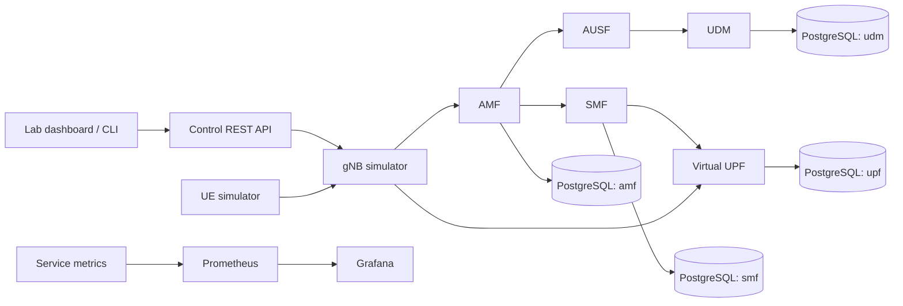

# Architecture

Core5G is an educational simulation. Real 5GC SBI interfaces are not these gRPC contracts; NAS, NGAP, radio, 5G-AKA and GTP-U are excluded.

Every service owns its schema. Application services communicate through protobuf contracts rather than reading another service's business tables. The control API is an aggregator, not a second business database.

The reference deployment uses one active instance of each stateful service. It is a local lab, not a highly available telecom system. Horizontal multi-writer operation requires an explicit distributed workflow/lease design and is not claimed.

Synthetic profiles are seeded for reproducible demonstrations. Subscriber authentication is fictional and does not secure the administrative API. Bind development ports to loopback and use a trusted environment.

References: [gRPC Go documentation](https://grpc.io/docs/languages/go/), [pgx](https://github.com/jackc/pgx), and the [project specification](specification.md).
