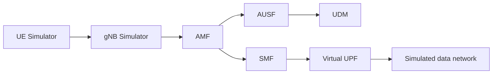
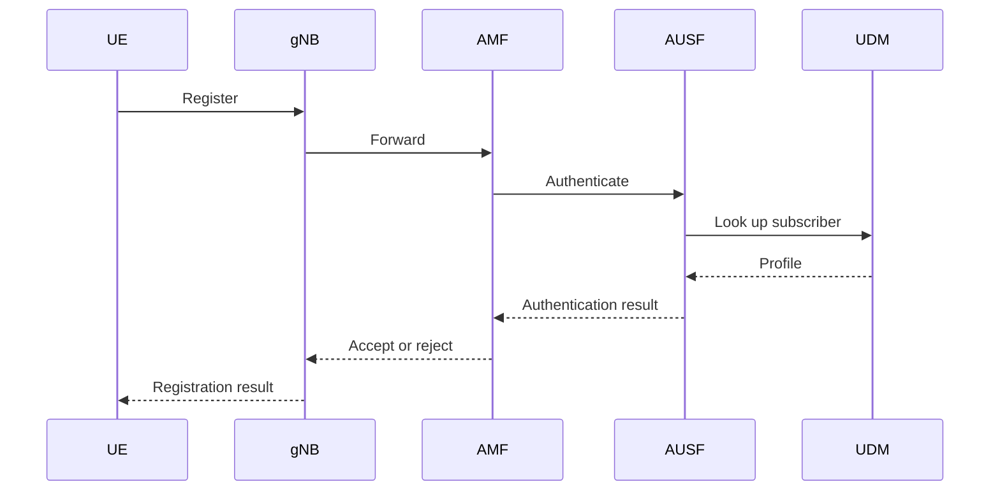
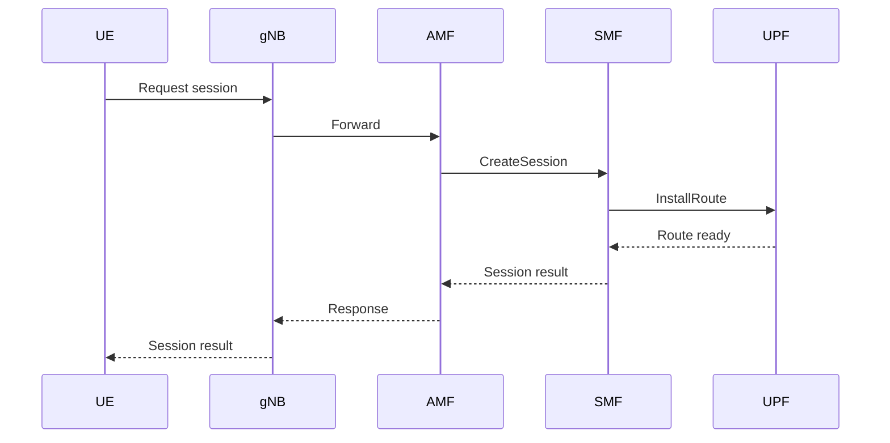
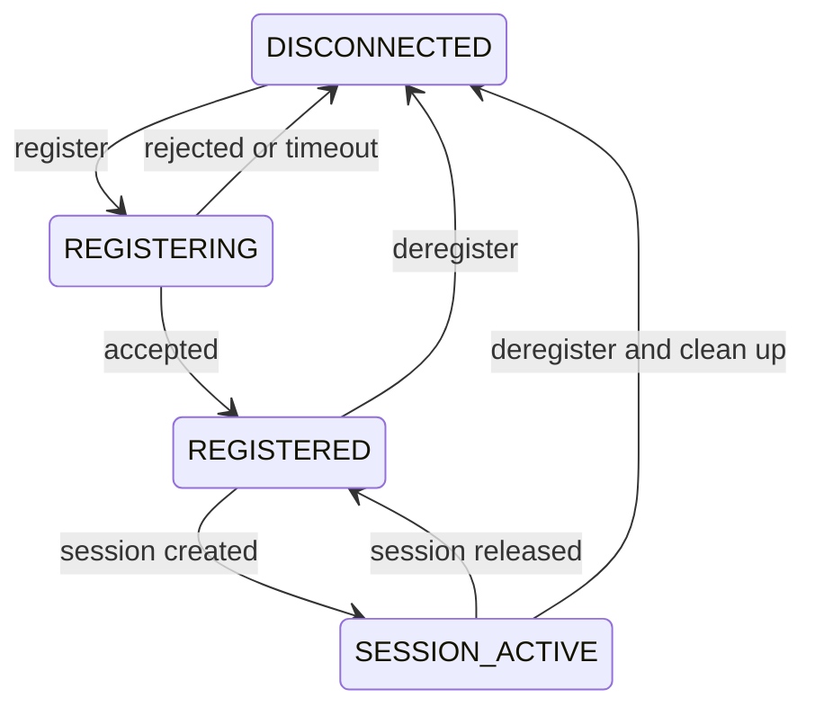

# Core5G technical specification V2.0

**Cloud-Native 5G Core Network Simulator**

English translation of the supplied V2.0 specification, dated October 21, 2026. Requirement identifiers and numerical targets are preserved. The source was a proposal to validate before implementation; this document states requirements rather than claiming they have all been achieved. Current implementation evidence is recorded in [requirements](requirements.md) and [validation](validation.md).

| Property | Value |
| --- | --- |
| Main language | Go |
| Architecture | Microservices / gRPC |
| Platform | Linux, Docker, Kubernetes |
| Scope | Educational simulation |

## Executive summary

Core5G is an educational simulator inspired by the 5G core network, implemented in Go. It reproduces virtual-device registration, fictional authentication, session establishment and simulated packet exchanges. It is neither a 3GPP-conformant implementation nor a production 5G core. gRPC communications are a teaching abstraction: actual 5GC service-based interfaces use other contracts, including HTTP/2 and 3GPP APIs. The MVP user plane does not implement GTP-U.

## 1. Vision, objectives and scope

### 1.1 Objectives

1. Simulate UE and PDU session lifecycles.
2. Design independent, testable Go services.
3. Use gRPC, Protocol Buffers, PostgreSQL, Docker and observability.
4. Measure performance and behavior under failures.
5. Deliver a demonstrable repository with tests and documentation.

### 1.2 MVP and exclusions

The MVP includes UE Simulator, gNB Simulator, AMF, AUSF, UDM, SMF, virtual UPF, a control API, persistence, metrics and Docker Compose.

5G radio, actual 5G-AKA, conformant NAS/NGAP, GTP-U, multi-cluster Kubernetes, network slicing and an AI agent are outside the MVP. They may be considered for a later version.

## 2. Architecture and diagrams

### 2.1 Logical simulator view



This is a simplified logical architecture. The arrows do not represent conformant 3GPP interfaces.

### 2.2 Microservices and storage

The REST control API drives the UE/gNB simulators and Go services through defined contracts. PostgreSQL provides persistence. Prometheus and Grafana provide monitoring. The exact service paths are formalized in Protobuf contracts. See [the implemented architecture](architecture.md) for actual service boundaries and calls.

### 2.3 UE registration sequence



### 2.4 PDU session creation sequence



This sequence is a simplified logical model.

### 2.5 UE state machine



### 2.6 Conceptual data model

| Entity | Primary key | Main fields and relationship |
| --- | --- | --- |
| Subscriber | `supi` | `status`, `auth_profile`; one subscriber has many UEs |
| UserEquipment | `ue_id` | `supi`, `state`; one UE has many PDU sessions |
| PDUSession | `session_id` | `ue_id`, IP, state; one session has many traffic records |
| TrafficRecord | `record_id` | `session_id` and traffic observations |

### 2.7 Deployment

CLI/dashboard -> control API -> Go/gRPC services, backed by PostgreSQL and observed through Prometheus/Grafana. Run locally with Docker Compose first, then a local Kind cluster.

## 3. Functional requirements

### F01 - UE management

- **F01.1:** Create a UE with a UUID `ue_id` and a valid synthetic SUPI.
- **F01.2:** A UE cannot be registered twice simultaneously. A second request receives an idempotent result or an explicit status code.
- **F01.3:** Allowed states are `DISCONNECTED`, `REGISTERING`, `REGISTERED` and `SESSION_ACTIVE`.
- **F01.4:** Registration timeout returns the UE to `DISCONNECTED` and logs the failure.
- **F01.5:** Deregistration releases sessions or explicitly reports cleanup failures.

### F02 - Fictional authentication

- **F02.1:** AUSF checks profile existence and status through UDM.
- **F02.2:** No production secrets or real subscriber identities are used.
- **F02.3:** Results include `AUTHORIZED`, `UNKNOWN_SUBSCRIBER`, `DISABLED_SUBSCRIBER`, `INVALID_CREDENTIALS` and `UNAVAILABLE`.
- **F02.4:** AMF never accepts a UE when the authentication response is missing or negative.

### F03 - Simulated PDU sessions

- **F03.1:** Only a registered UE can request a session.
- **F03.2:** Each session has a UUID, `ue_id`, virtual IP address, status, timestamps and counters.
- **F03.3:** Allocated IP addresses are unique among active sessions.
- **F03.4:** Creation is idempotent by `request_id`; replay does not create another session.
- **F03.5:** If UPF configuration fails, the session does not become `ACTIVE` and the IP is released.
- **F03.6:** States are `CREATING`, `ACTIVE`, `RELEASING`, `RELEASED` and `FAILED`.

Implementation clarification for F03.5: IP release must also respect the confirmed-cleanup guarantee in section 5.2. An uncertain external cleanup keeps the IP reserved until reconciliation confirms removal; see [ADR 0002](adr/0002-persistence-and-sagas.md).

### F04 - Virtual traffic

- **F04.1:** A packet has `session_id`, source, destination, size and timestamp.
- **F04.2:** Packets without an `ACTIVE` session are rejected.
- **F04.3:** Latency, jitter and loss are configurable with a reproducible random seed.
- **F04.4:** Track sent, received, rejected and lost packets and bytes.

### F05 - Monitoring and control

- **F05.1:** A REST API starts simulations, lists UEs/sessions and injects faults.
- **F05.2:** Services expose Prometheus metrics and JSON logs with `trace_id` and `request_id`.
- **F05.3:** Provide availability and readiness health checks.
- **F05.4:** A minimal dashboard shows registered UEs, active sessions, latency, errors and lost packets.

## 4. Contracts and integration rules

### 4.1 Minimum gRPC services

| Service | RPCs | Responsibility |
| --- | --- | --- |
| AMF | `RegisterUE`, `DeregisterUE`, `GetUEState` | Registration and state |
| AUSF | `Authenticate` | Authentication result |
| UDM | `GetSubscriber` | Synthetic subscriber profile |
| SMF | `CreateSession`, `GetSession`, `ReleaseSession` | Session lifecycle |
| UPF | `InstallRoute`, `RemoveRoute`, `SendPacket` | Virtual routing |

### 4.2 Reference Protocol Buffers contract

The original specification provides this illustrative contract. The implemented API is defined in [core.proto](../api/proto/core/v1/core.proto), which is the authoritative source for generated code.

```protobuf
syntax = "proto3";
package core5g.amf.v1;
option go_package = "core5g/api/gen/amf/v1;amfv1";

service RegistrationService {
  rpc RegisterUE(RegisterUERequest) returns (RegisterUEResponse);
  rpc DeregisterUE(DeregisterUERequest) returns (DeregisterUEResponse);
}
message RegisterUERequest {
  string request_id = 1;
  string ue_id = 2;
  string supi = 3;
  string gnb_id = 4;
}
message RegisterUEResponse {
  bool accepted = 1;
  string registration_id = 2;
  string state = 3;
  string reason_code = 4;
}
message DeregisterUERequest { string request_id = 1; string ue_id = 2; }
message DeregisterUEResponse { bool success = 1; }
```

### 4.3 Errors and deadlines

| Situation | Required behavior |
| --- | --- |
| Invalid input | `INVALID_ARGUMENT`, without state mutation |
| Missing UE or session | `NOT_FOUND` |
| Forbidden transition | `FAILED_PRECONDITION` |
| Unavailable dependency | `UNAVAILABLE`, controlled failure |
| Deadline exceeded | `DEADLINE_EXCEEDED`, compensation when necessary |
| Duplicate request | Idempotent response based on `request_id` |

Initial configurable deadlines are two seconds per interservice call and five seconds for an end-to-end workflow. Adjust these starting values after testing. Retries are only allowed for idempotent operations, with bounded backoff.

## 5. Persistence and concurrency

### 5.1 Reference SQL model

The following is the conceptual SQL model from the specification. Actual service-owned JSONB storage, generated columns and constraints are defined in [the migration](../migrations/001_initial.sql).

```sql
CREATE TABLE subscribers (
  supi VARCHAR(32) PRIMARY KEY,
  status VARCHAR(24) NOT NULL,
  auth_profile VARCHAR(80) NOT NULL
);
CREATE TABLE user_equipments (
  ue_id UUID PRIMARY KEY,
  supi VARCHAR(32) NOT NULL REFERENCES subscribers(supi),
  gnb_id VARCHAR(64),
  state VARCHAR(24) NOT NULL,
  updated_at TIMESTAMPTZ NOT NULL DEFAULT now()
);
CREATE TABLE pdu_sessions (
  session_id UUID PRIMARY KEY,
  request_id UUID NOT NULL UNIQUE,
  ue_id UUID NOT NULL REFERENCES user_equipments(ue_id),
  ip_address INET,
  state VARCHAR(24) NOT NULL,
  created_at TIMESTAMPTZ NOT NULL DEFAULT now(),
  released_at TIMESTAMPTZ
);
CREATE UNIQUE INDEX uq_active_ip ON pdu_sessions(ip_address)
WHERE state IN ('CREATING', 'ACTIVE', 'RELEASING')
  AND ip_address IS NOT NULL;
```

### 5.2 Guarantees

- State transitions are atomic, using version checks or transactional locks.
- Concurrent operations on the same UE are logically serialized.
- Released IP addresses are reusable only after cleanup is confirmed.
- Services do not directly share their business tables. The MVP may use one PostgreSQL instance with separate schemas.
- Aggregated traffic records must not saturate the transactional database.

## 6. Nonfunctional requirements

| ID | Requirement | Verification |
| --- | --- | --- |
| NF01 | Load objective of 1,000 concurrent UEs | Reproducible scenario |
| NF02 | Local registration p95 below 100 ms; a target rather than a guarantee | Benchmark report |
| NF03 | No crash during simulated failures | Resilience tests |
| NF04 | 80% coverage for critical business packages | `go test -cover` |
| NF05 | No known data race | `go test -race` |
| NF06 | One-command Docker Compose startup | Installation test |
| NF07 | Metrics, structured logs and traces | Grafana verification |
| NF08 | No real secrets committed | CI and code review |

Results depend on hardware. Document CPU, RAM, OS, connection count, workload profile and iteration count.

## 7. Implementation plan

### 7.1 Target layout

```text
core5g/
  cmd/{amf,ausf,udm,smf,upf,ue-simulator,gnb-simulator,control-api}/
  internal/{registration,authentication,session,routing,subscriber}/
  api/proto/
  api/gen/
  pkg/{config,logging,telemetry}/
  migrations/
  deployments/{docker,kubernetes}/
  tests/{integration,e2e,performance}/
  docs/
  .github/workflows/
  docker-compose.yml
  Makefile
  go.mod
  README.md
```

### 7.2 Phases and exit criteria

| Phase | Deliverable | Exit criterion |
| --- | --- | --- |
| 1 | Repository, Makefile, CI, Protobuf and Docker | Build and basic tests pass |
| 2 | UDM, AUSF, AMF and UE/gNB | Accepted and refused registration paths pass |
| 3 | SMF, virtual UPF and IPAM | Sessions and virtual traffic work |
| 4 | Monitoring and failure scenarios | Metrics and errors are observable |
| 5 | Kubernetes/Kind, load and documentation | Reproducible demo and report |

### 7.3 Development rules from the source specification

1. Read the specification before making changes.
2. Produce a plan and identify ambiguities before coding.
3. Use a feature branch per feature rather than modifying `main` directly.
4. Write feature tests and run `go test ./...` and `go vet ./...`.
5. Do not claim a feature is complete without test evidence.
6. Keep README, ADRs and API documentation current.
7. Never invent benchmark results.

These are translated source requirements. The current review workflow is documented in [CONTRIBUTING.md](../CONTRIBUTING.md).

## 8. Acceptance scenarios

| ID | Action | Expected result |
| --- | --- | --- |
| T01 | Register a known subscriber | `REGISTERED` |
| T02 | Register an unknown SUPI | Rejection without entering `REGISTERED` |
| T03 | Replay the same request | No duplication |
| T04 | Create a session for a registered UE | `ACTIVE` and unique IP |
| T05 | Create a session for an unregistered UE | `FAILED_PRECONDITION` |
| T06 | Send a packet on an `ACTIVE` session | Counters updated |
| T07 | Send a packet on a `RELEASED` session | Controlled rejection |
| T08 | Stop UPF during creation | Failure and compensation |
| T09 | Release a session twice | Idempotency |
| T10 | Run 1,000 UEs | Report p50/p95/p99, errors and CPU/RAM |

## 9. Risks and future work

| Risk | Mitigation |
| --- | --- |
| 3GPP complexity | Distinguish educational simulation from actual conformance |
| Inconsistent states | Atomic transitions, idempotency and compensation |
| Excessive coupling | Protobuf contracts and explicit data ownership |
| Load and latency | Progressive benchmarks and Go profiling |
| Kubernetes complexity | Validate Docker Compose first |

Possible later work includes interfaces inspired by 3GPP SBI specifications, experimental GTP-U, simplified network slicing, a C++ packet-processing module, an AI diagnostic agent and multi-cluster Kubernetes.

## 10. Final deliverables

- GitHub repository with branch and pull request history.
- Go code, Protobuf files and generation scripts.
- PostgreSQL migrations, Docker Compose and Kind/Kubernetes manifests.
- Unit, integration, E2E, load and resilience tests.
- Metrics dashboard and performance report.
- Architecture, API and decision documentation, plus a demonstration guide.
- Screenshots or video of an actual execution.

## 11. Source references

- 3GPP TS 23.501: System Architecture for the 5G System.
- 3GPP TS 23.502: Procedures for the 5G System.
- 3GPP TS 29.500: Service Based Architecture.
- [gRPC documentation](https://grpc.io/docs/)
- [Go documentation](https://go.dev/doc/)
- [Kubernetes documentation](https://kubernetes.io/docs/)
- [Open5GS](https://open5gs.org/)
- [free5GC](https://free5gc.org/)
